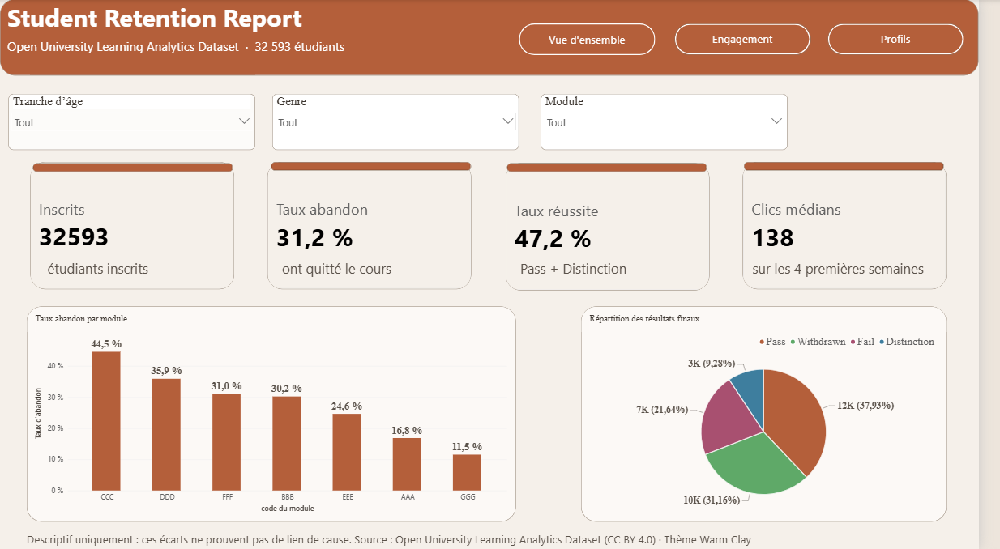
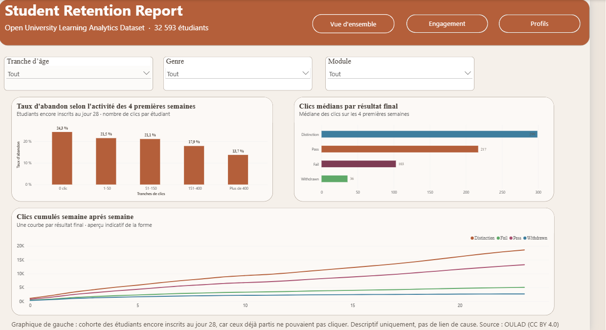
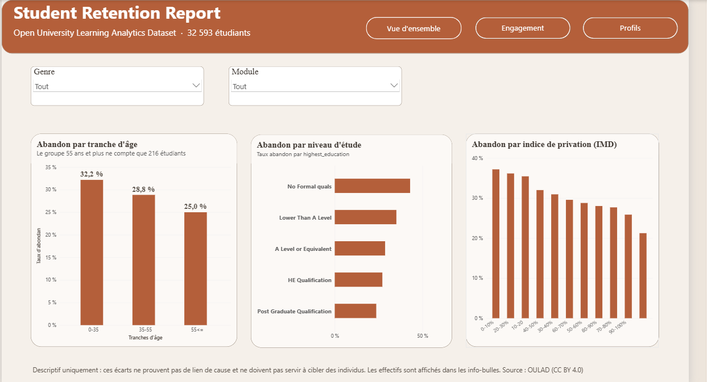

# OULAD – Engagement précoce et abandon en formation à distance

Analyse descriptive de l'activité des 4 premières semaines et de son lien
apparent avec l'abandon, sur l'Open University Learning Analytics Dataset
(32 593 inscriptions, 10,6 millions de lignes de clics).

## Problématique
Quels signaux d'engagement observés dans les 4 premières semaines sont
associés à l'abandon ensuite ? L'objectif est de repérer à temps les
étudiants à accompagner. L'étude est **descriptive : aucun lien de cause
n'est établi**.

## Méthode
- **SQL (SQLite)** : jointures, CTE, fonctions de fenêtrage, requêtes
  exécutées depuis le notebook.
- **Python (Pandas, Seaborn)** : exploration, contrôles de qualité, graphiques.
- **Power BI (DAX)** : tableau de bord en 3 pages (Vue d'ensemble,
  Engagement, Profils).
- **Correction du biais de cohorte** : l'analyse porte sur les étudiants
  encore inscrits au jour 28, car ceux partis avant ne pouvaient plus cliquer.

## Résultats
- **Abandon global :** 31,2 % des inscriptions (10 156 sur 32 593).
- **Par module :** de 11,5 % (GGG) à 44,5 % (CCC).
- **Sans aucun clic en 4 semaines :** 79,9 % d'abandon sur l'ensemble des
  étudiants, mais ce chiffre est gonflé par les étudiants déjà désinscrits.
  Après correction (étudiants encore inscrits au jour 28) : **24,3 % contre
  18,3 %** pour ceux qui ont cliqué au moins une fois.
- **Selon le nombre de clics (cohorte corrigée) :** l'abandon baisse de
  24,3 % (0 clic) à 13,7 % (plus de 400 clics).
- **Clics médians sur 4 semaines :** Distinction 299, Pass 217, Fail 103,
  Withdrawn 36.
- **Par âge :** 32,2 % (0-35 ans), 28,8 % (35-55 ans), 25,0 % (55 ans et
  plus, seulement 216 étudiants).

## Aperçu du tableau de bord

## Limites
- Étude descriptive : une association n'est pas une cause.
- Les médianes de clics portent sur tous les étudiants, y compris ceux
  désinscrits avant le jour 28.
- Tranche des 55 ans et plus : 216 étudiants, à interpréter avec prudence.
- Le choix de la fenêtre de 28 jours écarte les départs les plus précoces.

## Reproduire
1. Installer les dépendances : `pip install -r requirements.txt`
2. Ouvrir le notebook et l'exécuter de haut en bas : il télécharge les
   données (avec vérification de l'intégrité) et construit la base SQLite.

## Sources et crédits
- Kuzilek, J., Hlosta, M., Zdrahal, Z. *Open University Learning Analytics
  Dataset*, Scientific Data, 2017. Licence CC BY 4.0.
- Thème Power BI : Warm Clay.
